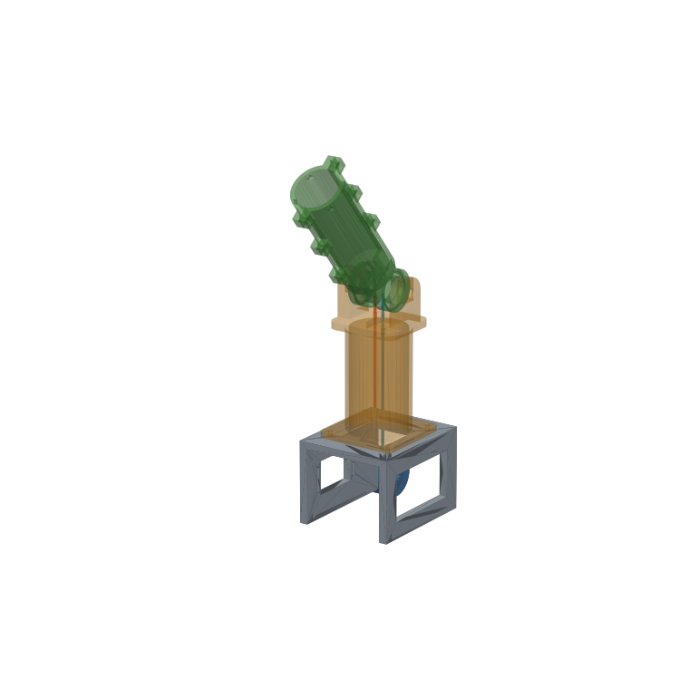

# Tendon Torso

An open, fully 3D-printed **tendon-driven torso with two arms**. All motors sit in the torso, and the tendons run hidden through the hollow core of every link, through shoulder, elbow and wrist, down to simple grippers.

We build it up one joint at a time.



## Status

| Part | Status |
|---|---|
| [J1: 1-DOF tendon hinge test rig](joints/j1-hinge/) | designed, STL ready, **not printed/tested yet** |
| J1b: two stacked joints, motors remote | next |
| Gripper, shoulder, full arm, torso | see [roadmap](docs/roadmap.md) |

## Repo layout

```
docs/research.md      existing open designs + why J1 looks the way it does
docs/roadmap.md       path to the torso, the tendon-routing problem
joints/j1-hinge/      parametric CadQuery source, STL/STEP, build guide
tools/render.py       preview renders + range-of-motion collision check
```

## Building the CAD

Everything is parametric Python ([CadQuery](https://cadquery.readthedocs.io/)). Change a number, then regenerate:

```bash
python3 -m venv .venv && .venv/bin/pip install -r requirements.txt
.venv/bin/python joints/j1-hinge/j1_hinge.py
.venv/bin/python tools/render.py
```

STEP files open in Fusion, FreeCAD, Onshape or Rhino.

## License

[MIT](LICENSE): use it, remix it, sell it, just keep the notice. Contributions and build reports are welcome.
