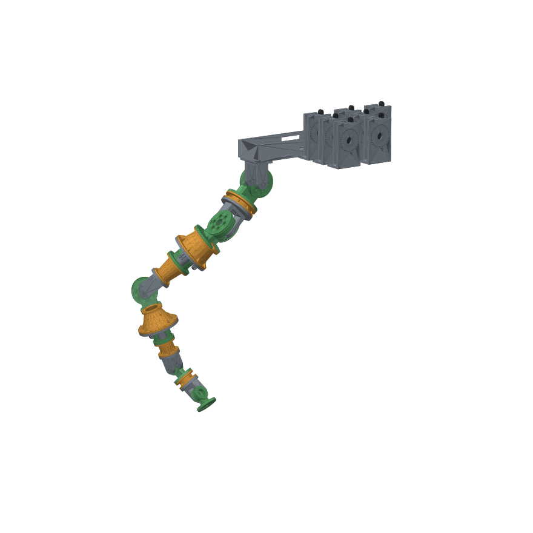

# Tendon Arm: 7 DOF, hand-cranked, fully printable

A human-like arm without a hand. All seven joints are driven by **1 mm Dyneema** cords in **PTFE Bowden tubes** from seven **hand cranks** next to the shoulder. Every crank sits where a motor (NEMA17 + spool) will go later.



Interactive 3D model: open `docs/viewer/` (tab *Arm · 7 DOF*), see the repo [README](../README.md).

| | Joint | Type | Range | Moment arm | Crank turns, full range |
|---|---|---|---|---|---|
| S1 | Shoulder flexion (forward) | hinge L | −30…+120° | 42 mm | 2.2 |
| S2 | Shoulder abduction (sideways) | hinge L | −10…+100° | 42 mm | 1.6 |
| S3 | Upper-arm rotation | roll (2× 6806) | ±80° | 28 mm | 1.6 |
| E | Elbow | hinge M | 0…+115° | 36 mm | 1.4 |
| F | Forearm twist | roll (2× 6805) | ±85° | 25.5 mm | 1.5 |
| W1 | Wrist flexion | hinge S | ±60° | 20 mm | 0.8 |
| W2 | Wrist tilt | hinge S | ±30° | 20 mm | 0.4 |

Upper arm is 300 mm (S2 axis to elbow), forearm 250 mm (elbow to wrist). The arm hangs about 0.9 m below the shoulder beam, so mount the beam on a high table, shelf or bench edge.

## Controlling the hand (kinematics)

Give a hand position (and optionally an orientation) and get the 7 joint angles plus the turns for each crank:

```bash
.venv/bin/python -m arm.ik -40 164 -695
```

The equations, solver and accuracy are in [docs/kinematics.md](../docs/kinematics.md). The viewer's **Reach mode** runs the same solver live in the browser.

## How it's built

```
crank ×7 ──PTFE tubes──► shoulder beam ──► S1 ─ S2 ─ link ─ S3 ─ upper link ─ E ─ link ─ F ─ forearm link ─ W1 ─ W2 ─► (gripper plate)
                                           hinge hinge      roll               hinge     roll                 hinge hinge
```

* **Hinge module** (`hinge.py`): base + two rotor halves.
  * **Base:**
    * a plate with heat-set inserts;
    * two lugs with captive nuts for the stub axles: M8×20 into 608 bearings on the shoulder (S1, S2), M5×16 into 625 bearings on the elbow and wrist (E, W1, W2);
    * a boss with two angled Bowden sockets aimed exactly along the drum tangents;
    * a slot that lets the tubes of the joints further out pass through.
  * **Rotor:** printed as two halves split on the motion plane, each flat on that face.
    * The drum is hollow, with the bearings at its ends.
    * Each half has one cord groove with a knotted chord anchor.
    * A top plate with inserts holds the next link.
* **Roll module** (`roll.py`): stator + rotor + retainer + 2 idlers. Check the race shoulder sizes of the 6806/6805 you buy against `roll.py`.
  * The stator tube carries two thin-section bearings.
  * The rotor ring holds their outer races and has two grooves.
  * Each cord comes up from a socket in the stator plate and turns 90° over a 623 idler pulley onto the rotor.
  * The bore stays open for the tubes going further down.
* **Links** (`link.py`):
  * tubes with outward bolting lips, bolt heads on the lips;
  * a full 48° cone carries the top lip, with a counterbore up through it for each bolt head;
  * on the S→XM link the bottom bolts are reached with a hex key from inside the wide bore.
* **Crank module** (`crank.py`):
  * an M8 shaft on two 608s, with a helical spool clamped between them;
  * a crank arm with a **lock pin** that indexes every 10° on a ring of holes;
  * two **socket blocks** (A and B), one per cord, each pulled up by its own M4 screw (10 mm travel), so each cord's length and pretension is set on its own;
  * a **tube clip** on top, held by the two tension screw heads, that guides both tubes out vertically.
* **Shoulder balance** (`balance.py`): two springs on cords from a yoke on `link_s1_s2` over sheaves on the beam; see below.
* **Torso** (`torso.py`):
  * a U-channel shoulder beam that screws onto the table and overhangs its edge, with S1 bolted underneath;
  * crank racks for 3 cranks each;
  * two snap-in **tube combs** that hold the 14 tubes in a labelled grid (S1 … W2 × A/B) inside the channel.
* **Fittings** (`fittings.py`): a cord thimble to join Dyneema to a spring hook or an eye.

## Gravity balance springs (`balance.py`)

Two springs take most of the arm's weight off S1, so the S1 crank (and later its motor) works much less.

**How it works (zero-free-length balancing).** Each side has a Dyneema cord. It starts at a pin **B** on the arm, b = 81 mm below the S1 axis, and runs over a sheave **A**, a = 113 mm straight above the axis. From there it goes back along the beam to an extension spring. The spring pulls with F = k·|AB| (it behaves as a zero-length spring; see below). Then its moment about S1 is k·a·b·sin(S1), and the arm's weight moment is m·g·d·sin(S1). Both follow the same sine, so one setting balances the arm at every flexion angle. The two cords run in the side planes x = ±85 mm, outside the beam and the S1 base. They are symmetric, so the S1 bearings see no twist.

* **Yoke:** `link_s1_s2` has two flat arms out to x = ±85 mm. Its flanges and its 22 mm length are unchanged, so the kinematics stay the same. Each arm ends in a fork with an M3 pin, and the cord is tied in a loop around the pin. The loop pivots, so the cord line always passes through the pin centre. The arm tips slope down towards S2, which leaves room for the upper arm at full abduction (S2 = 100°).
* **Masts (`balance_mast_l/_r`):**
  * Each mast hooks over its beam side wall: a top cap, an inner lip and a front lip around the beam's front end.
  * Fix it with 2× M4 through the wall. Drill Ø4.5 through the beam wall, using the mast as the jig. The nuts go inside the channel.
  * It carries the sheave on two 623s and an M3 axle. The sheave centre sits 10 mm behind the S1 axis, so the hanging cord passes exactly over the axis.
  * A fairlead at the back sends the cord backwards at z = 54 mm.
* **Springs + anchor posts (`balance_post` ×2):**
  * The springs run 1:1 (no tackle) along x = ±85 mm, beside the beam and the crank racks. The racks moved to x = 220 to make room.
  * Each spring hooks onto an **M5 eye bolt** through a post that is screwed to the table at y ≈ 290–340 mm.
  * The two nuts on the eye bolt tune the spring offset by ±20 mm.

**Balance level.** The mass model is shared with `statics.py`. It takes the CAD volume and surface of every printed part: the skin (walls + top/bottom layers) prints solid, the rest at the part's infill (links 3 walls + 15%, modules 4 walls + 25%; see Print list). Bearings, axles, inserts, bolts and the PTFE tubes are added as point masses.

| | |
|---|---|
| Mass moving with S1 | 1.43 kg (0.96 kg PETG + 0.47 kg hardware) |
| COM below S1, arm straight | 360 mm, so m·g·d = **5.1 N·m** (9.6 N·m with 0.5 kg in the hand) |
| Effective lever, elbow bent 0/60/115° | 360 / 328 / 269 mm |

A spring can only follow sin(S1). At full abduction (S2 = 100°) the arm's weight moment about S1 falls to well under half of that. So the spring level is the **minimax** over all S1 × S2 × E poses: k·a·b = 3.3 N·m for both sides together.

**Result** (`tools/check_balance.py`, real sheave geometry):

| | Without springs | With springs |
|---|---|---|
| Peak S1 holding torque (S1 × S2 × E ranges) | 5.1 N·m | **1.85 N·m (−63%)** |
| Force on the S1 crank knob | 15.5 N | **5.7 N** |
| With 0.5 kg payload | 9.6 N·m / 29.5 N | 6.4 N·m / 19.7 N |

The springs don't act on S2: its peak stays 3.0 N·m.

**Spring (one per side).**

| Property | Value |
|---|---|
| Material | Music-wire extension spring |
| Wire | Ø 1.2 mm |
| OD | 15 mm |
| Free length | 105 mm over the hooks |
| Rate | k = 0.18 N/mm |
| Active coils | about 43 |
| Initial tension | ≤ 10 N |
| Working load | 17–34 N |
| Safe load | 40 N (45% of Rm in shear) |
| Extension in use | 80–175 mm (max length ≥ 290 mm) |

* **Where to buy:** any catalogue extension spring close to 0.18 N/mm, OD ~15 mm, ~105 mm free length. Before buying, check that initial tension is ≤ 10 N and maximum extended length is ≥ 290 mm. A rate within ±0.02 N/mm still keeps ≥ 62% balance (re-run `tools/check_balance.py` with your value in `balance.K_SPRING`).
* **Initial tension does not spoil the balance.** The spring pulls with Fi + k·e. Moving the anchor by Fi/k makes that equal k·|AB|, as long as the spring stays open over the whole range. That needs Fi < k·|AB|min ≈ 18 N.
* **No 2:1 tackle.** With a 1:1 run the cord pull stays at ≤ 35 N and the parts stay simple. The 175 mm extension fits along the table. A 2:1 tackle would halve the stroke but double the spring load and add a moving pulley.

**Fitting and tuning.**
1. Tie each cord to its yoke pin with a bowline loop.
2. Run the cord up over the sheave, through the fairlead and back to the spring hook. The cord is about 0.41 m per side, including the knots.
3. With the arm hanging, set the eye-bolt nuts so the spring is stretched by about 180 mm (spring length about 288 mm).
4. Then fine-tune: the arm should hold still at S1 = 30° with the crank lock pin out.

## Printability (`tools/printability.py`)

**All 41 parts print without supports** in the orientation they are exported in. The check:
* no overhang steeper than 45°;
* no flat bridge wider than about 8 mm;
* no wall under 1.2 mm;
* one watertight body per part, fitting a 250 mm bed.

Notable orientations:
* **Hinge rotor halves** print **top plate down**. Their tube window opens upward, the bearing pockets are teardrops, and the drum top is covered by the neck. Near the top of the drum the cord runs through a short closed channel in the neck: thread it with a CA-stiffened tip after tying the knot.
* **Roll rotors** print top plate down.
* **The crank spool** prints standing on its boss. Its grooves are 0.5 mm deep at 1.9 mm pitch, about 3.4 turns per cord.
* **Crank frames** print foot down. The top beam has a 48° roof and the bearing holes are teardrops.

```bash
.venv/bin/python -m arm.export && .venv/bin/python tools/printability.py arm/stl
```

## Checked in CAD (`tools/check_arm.py`)

* All parts are valid, watertight single solids, and **every part fits a 250 mm bed**.
* **Every joint is collision-free at both range limits.** So are 7 combined poses (elbow fully bent with forearm twist and wrist, shoulder raised and rotated, and so on).
* Cords from each tube exit to its drum tangent and along the groove touch nothing, in every hinge and roll joint.
* Crank arms of neighbouring modules never touch, and the knob clears the table.
* Every joint's center passage is big enough for the tubes that pass through it (12 at S1, down to 2 at W1).
* The balance hardware (yoke, masts, sheaves, cords, springs, posts) touches nothing at the S1/S2 limits and in combined poses. That includes the beam, the S1 base and the crank racks. The yoke keeps clear of the upper arm at full abduction. **Reach limit added by the balance:** with the hand folded back over the shoulder (S2 > 90°, S3 < −70° and E > 105° all together), the wrist touches the −X mast. Every other combination clears it.

**Not verified (needs the printed arm):**
* friction through the long tube runs;
* real stiffness and backlash;
* print tolerances (bearing fits, heat-set insert holes);
* how the tubes actually lie inside the links.

## Weight optimisation

Same mass model for both columns (CAD volume + surface, skin solid, per-part infill, hardware as point masses):

| | Before | After |
|---|---|---|
| Printed PETG (4 walls + 40% everywhere → link/module profiles) | 1468 g | 1023 g |
| Hardware | 704 g | 563 g |
| **Arm total** | **2.17 kg** | **1.59 kg (−27%)** |
| S1 worst-case torque (0.3 kg payload) | 10.4 N·m | 7.8 N·m (−25%) |
| S1 peak with the balance springs (no payload) | 2.9 N·m | 1.85 N·m |

What changed, by how much it helps the shoulder:

* **Elbow and wrist hinges on 625 bearings + M5 axles** instead of 608 + M8 (−141 g of steel at the far end of the arm). They see at most 120 N; a 625 is rated 670 N static. Lugs shrink with them.
* **Print profiles:** links 3 walls + 15%, modules 4 walls + 25%. Loads are tiny (link stress ≤ 1.3 MPa, insert pull ≤ 52 N), so 40% infill bought nothing.
* **Link walls 3 → 2 mm.**
* **Roll-stator flanges sized to the Bowden sockets** (XL lip Ø 126 → 113 mm, XM Ø 122 → 108 mm): the forearm and upper-arm cones are smaller.
* Not done, on purpose: hollowing the solid-looking cones. At 15% infill their inside is mostly air already; a cavity would only add two more solid skins.

## Loads (worst case over the workspace, 1.59 kg arm + 0.3 kg payload, no springs)

From `python -m arm.statics` (full table in `docs/loads_report.txt`); cord = torque / drum radius + 20 N pretension.

| | Joint torque | Cord tension | Force on the crank knob |
|---|---|---|---|
| S1 | 7.8 N·m | 207 N | 27 N |
| S2 | 5.3 N·m | 147 N | 19 N |
| S3 | 2.2 N·m | 100 N | 13 N |
| E | 2.3 N·m | 83 N | 11 N |
| W1 | 0.7 N·m | 57 N | 7 N |

* **Cord margin:** 1 mm Dyneema breaks around 1000 N, so the shoulder has about a 4× margin. Use 1.2–1.5 mm cord if you have it: change `CORD_D` in `params.py` and re-export.
* **Lock pins:** the arm won't hold itself up without them. Keep the pins in whenever you let go of a crank.

## Print list

`stl/PRINT_LIST.md` lists every file with its quantity and orientation; all STLs are already oriented for printing. Re-export with:

```bash
.venv/bin/python -m arm.export
```

**Material and settings:** PETG (or PLA+ for a first try), 0.2 mm layers, gyroid infill. Two profiles (the mass model uses the same ones):

* **Links** (`link_*`): 3 walls, 4 top/bottom layers, 15% infill. Their 2 mm tube walls print solid anyway; the worst link bending stress is 1.3 MPa.
* **Modules and everything else:** 4 walls, 25% infill. The shoulder beam gets 6 walls (see PRINT_LIST).

## Hardware

| Qty | Part | Where |
|---|---|---|
| 18 | 608ZZ bearing (8×22×7) | 2 per shoulder hinge S1, S2 (4), 2 per crank (14) |
| 6 | 625ZZ bearing (5×16×5) | 2 per elbow / wrist hinge E, W1, W2 |
| 2 | 6806-2RS (30×42×7) | upper-arm rotation |
| 2 | 6805-2RS (25×37×7) | forearm twist |
| 4 | 623ZZ (3×10×4) + M3×12 bolt (self-taps into the inner cheek, no nut) | roll idlers |
| 4 | M8×20 bolt, M8 nut, M8 washer | shoulder hinge stub axles |
| 6 | M5×16 bolt, M5 nut, M5 washer | elbow + wrist hinge stub axles |
| 7 | M8×70 (or M8×65) bolt + M8 nut | crank shafts |
| 80 | M3 heat-set insert (4.0 mm hole, 5.5 deep) | module plates |
| 76 | M3×10 bolt | links to modules |
| 4 | M3×12 bolt | S1 base to beam |
| 6 | M3×10 self-tapping | roll retainers |
| 14 | M4×45 bolt + nut | crank tension screws (one per socket block) |
| 28 | M4×12 bolt + nut | crank feet to racks |
| 7 | M4×30 bolt + nut | crank knobs |
| ~28 | 4×30 wood screws | beam, racks and balance posts to the table |
| 2 | Extension spring, music wire 1.2 × OD 15 × 105 mm, 0.18 N/mm | shoulder balance |
| 4 | 623ZZ (3×10×4) | balance sheaves (2 each) |
| 2 | M3×20 bolt (axle, self-taps into the outer cheek) + 2 M3 washers each | balance sheaves |
| 2 | M3×20 bolt + nut | balance cord pins in the yoke |
| 4 | M4×20 bolt + nut + washer | balance masts through the beam walls (drill Ø4.5) |
| 2 | M5×60 eye bolt + 2 M5 nuts + washers | balance spring anchors (±20 mm tuning) |
| ~1 m | 1 mm Dyneema (from the spool) | balance cords, ~0.41 m each |
| **~17 m** | **PTFE tube 2 mm ID × 4 mm OD** | 2 per joint, ~0.55 m (S1) to ~1.6 m (W2) |
| **~25 m** | **1 mm Dyneema** (buy a 50 m spool) | 2 cords per joint, ~1.25 m (S1) to ~2.2 m (W2) |

## Assembly order

1. **Melt in all heat-set inserts** first.
2. **Build each hinge.** Press the bearings (608 on S1/S2, 625 on E/W1/W2) into both rotor halves.
   1. For each cord: tie a double overhand knot, pull the cord from the knot pocket through the chord hole into the groove, and lay it over the drum. Cord A goes on the −X half, cord B on the +X half; they wrap opposite ways.
   2. Drop the nuts into the lug slots, set the rotor halves between the lugs, add washers and screw in the stub axles (M8×20 or M5×16).
   3. Thread each cord down through its angled socket in the base.
3. **Build each roll joint.**
   1. Press both thin-section bearings into the rotor, one from each side.
   2. Slide the rotor over the stator tube and screw the retainer on top (3× M3×10, reached through the rotor's open top before the next link goes on). The rotor is held **only** by these bearings: the retainer clamps the upper inner race and preloads the pair, and the rotor never touches the stator plate (the visible gap is running clearance).
   3. Fit the idlers (623 + printed tyre on an M3×16).
   4. Knot each cord into its rotor anchor, lay it in its groove to the tangent point, over the idler and down through the socket.
4. **Thread the tubes and bolt the chain together from the wrist upwards.**
   1. Start at W2. Push a PTFE tube over each cord and into its socket.
   2. Each time you add the next module or link above, feed **all** tubes that already exist through its center.
   3. Bolt each link with M3×10 through its lips into the inserts.
   4. Mark every tube at both ends with its joint and cord (A/B), for example with colored tape.
5. **Mount the shoulder beam** on the table edge (wood screws) and bolt the S1 base underneath it. Thread all 14 tubes through the two tube combs (each tube in its labelled hole), snap the combs into the side windows at y = 33 and y = 60, and lead the tubes along the channel to the cranks. Keep every free bend at R ≥ 25 mm.
6. **Fit each crank.**
   1. Feed its two tubes down through the tube clip and the beam and push them into the socket blocks (A on the +y block, B on the −y block). Put an M4 nut in each block's nut trap and screw an M4×45 through the clip and the beam into it.
   2. Put the joint at 0° and the crank lock pin in hole 0.
   3. Wind each cord **about 2 turns** onto the spool: cord A on the −X helix, cord B on the +X helix, both going *under* the spool. Pass the cord through the flange hole and knot it.
7. **Tension:** turn each crank's two M4 screws (one per cord) to lift its socket block until the joint has no play; use them separately to trim the joint's zero position. Re-tension after the first hours, because Dyneema and PETG both settle a little.

Tip: pre-stretch the Dyneema by hanging 5 kg on it overnight before cutting it to length.

## Later

* **Motors:** swap each crank for a NEMA17 + the J1-S spool. The tubes and joints stay as they are.
* **Gripper:** bolts onto the W2 rotor plate (4× M3). Its cable passes through W2's open center.
* **Second arm:** mirror the shoulder beam and add 7 more cranks.
