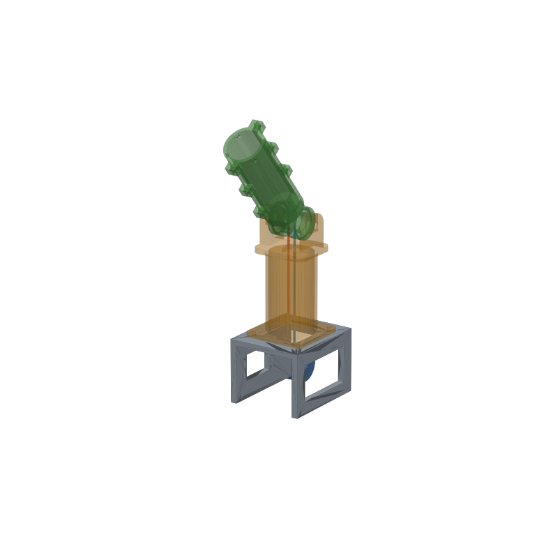
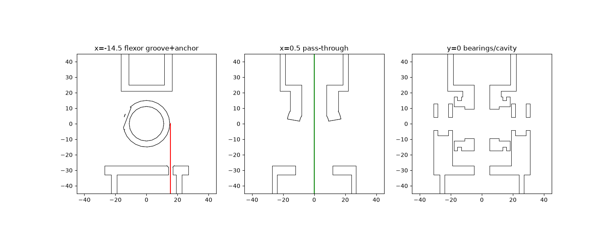
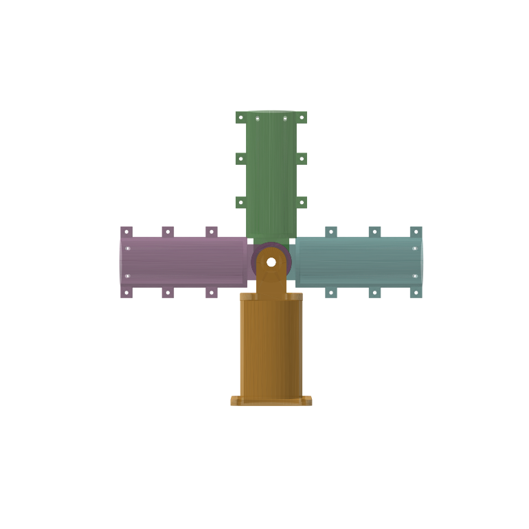

# J1: single-DOF tendon hinge (test rig)

The first building block for the arm. One hinge, driven by an **antagonistic tendon pair** from a servo that sits in the base (a stand-in for the torso). Its main job is to test the feature every later joint needs: **an open joint center, so tendons for distal joints can pass straight through the axis.**



## How it works

```
        distal link (2 identical halves)
              |   |
          ____|___|____        drum r=15.5 mm, rides on 2x 608 bearings
         /  flexor   \  <-- flexor wraps one way, extensor the other way
         |  [open]   |  <-- center is EMPTY: pass-through tendons cross the axis
         \___________/
          |  |   |  |      proximal link (hollow): tendons drop straight down
          |  |   |  |
         (  spool r=15.5 )  <-- servo spool, same radius -> 1:1, closed loop
              servo            slide the servo down in its slots to tension both
```

* **Closed-loop pair.** The flexor and extensor wrap the drum in opposite directions and wrap the spool the same way. When the servo turns, one tendon winds on and the other pays out by the same length, so one motor drives both directions with no slack. Drum and spool have the same radius, so joint angle = servo angle.
* **Straight routing.** Below the drum, both tendons run as straight vertical lines down the core to the spool. There are no pulleys or bends, so friction stays minimal.
* **Pass-through center.** The 608 bearings sit at the ends of the drum, and the M8 stub axles reach only into the bearings. The middle of the joint is an empty cavity with a slot open over ±100°. A cord that crosses the joint on its axis does not change length when the joint bends, so the next joints' tendons are decoupled from this one. See the [roadmap](../../docs/roadmap.md) for why this matters for the torso.
* **Printable halves.** The distal link is split on the motion plane. Both halves are the **same STL**, each printed flat on the split face. That gives round bearing pockets, round grooves and horizontal knot holes.

Sections, left to right: the flexor groove (red = tendon going straight down to the spool), the pass-through plane (green = a distal tendon crossing the axis), and the bearings/cavity.





Checked in CAD: no collisions between the distal and proximal links over **±98°**.

## Key numbers (all parameters are at the top of `j1_hinge.py`)

| | |
|---|---|
| Moment arm (drum radius at tendon) | 15.5 mm |
| Range of motion | ±98° (servo-limited to ±90° with a 180° servo) |
| Torque with MG996R (~1 N·m stall at 6 V) | ~1 N·m → ~65 N tendon tension |
| Proximal link | Ø54 mm, 136 mm tall |
| Distal link | Ø44 mm, 131 mm from the axis |
| Pass-through channel | 10 mm wide through the joint center |

## Bill of materials

| Qty | Part | Note |
|---|---|---|
| 1 | `proximal.stl` | print upright, flange on bed; support only under the cap (inside the tube) |
| 2 | `distal_half.stl` | **print twice**, flat side down, no supports |
| 1 | `spool.stl` | flat side down |
| 1 | `base.stl` | already oriented upside down (top plate on bed) |
| 2 | 608 bearing (8×22×7) | skateboard bearing, press fit |
| 2 | M8×20 bolt + M8 nut | axle stubs; the nut drops into the slot in each lug |
| 2 | M8 washer | fills the 1 mm gap between the drum and the lug (on the inner race only) |
| 6 | M3×12 + M3 nut | join the two distal halves |
| 4 | M3×16 + M3 nut | proximal flange to base |
| 4 | M3×10 + washer | servo into its slots |
| 1 | MG996R (or any standard-size) servo | 180° |
| ~1 m | 1.0 mm Dyneema / braided PE line | e.g. 100 lb fishing braid. Not mono nylon (it stretches) |

Print settings: PETG or PLA+, 0.2 mm layers, 4 walls, 30–40% gyroid infill. Use 100% infill or 6 walls around the lugs and drum if you can.

## Assembly

1. Press a 608 into each distal half.
2. **Flexor:** tie a stopper knot (a double overhand works), thread the line from the knot pocket through the chord hole so it comes out in the groove, then wrap it over the top of the drum toward the front (+Y) side. Do the same for the extensor on the other half: it wraps the opposite way.
3. Bolt the halves together (6× M3). The two tendons now hang down on opposite sides.
4. Drop an M8 nut into each lug slot. Lower the drum between the lugs, threading each tendon through its hole in the cap. Push an M8 washer into each gap and screw the M8×20 bolts in from the outside through the nut. Snug them, but don't crush the bearings.
5. Bolt the proximal flange to the base. Fit the spool to the servo's round horn with the small horn screws, set the servo to its **center** position, and attach the servo loosely in its slots.
6. With the joint straight, wrap each tendon around the spool in the matching direction, pass it through the spool's chord hole and tie it off in the knot pocket.
7. **Tension:** push the servo down in its slots until both lines are taut, then tighten the 4 screws. Do the coarse adjustment with the knots and the fine adjustment with the slots.

## Things to test with this rig (they feed the next design)

- [ ] Backlash: wiggle the distal link with the servo holding. Is the play in the tendons or in the bearings?
- [ ] Creep: hang a load at the tip overnight and re-measure the angle.
- [ ] Friction: does the joint backdrive by hand with the servo unpowered?
- [ ] **Pass-through coupling:** run a test cord from the base, through the center slot, out the top. Mark it, then sweep the joint ±90° and measure how much the mark moves. Ideally ≈0.
- [ ] Measure your servo: check `SERVO_TAB_TO_HORN`, `SERVO_SHAFT_OFF` and `HORN_HOLE_R`, which are estimates for an MG996R.

## Regenerating

```bash
python3 -m venv .venv && .venv/bin/pip install -r requirements.txt
.venv/bin/python joints/j1-hinge/j1_hinge.py   # STL + STEP -> joints/j1-hinge/stl/
.venv/bin/python tools/render.py               # previews + collision check
```
