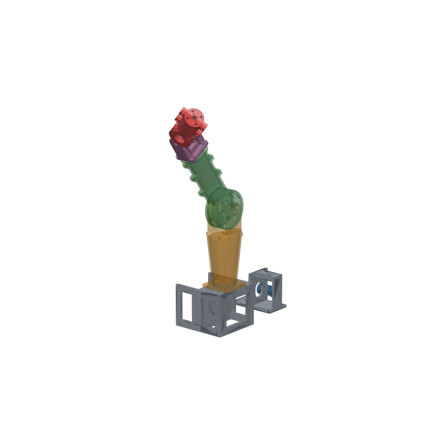
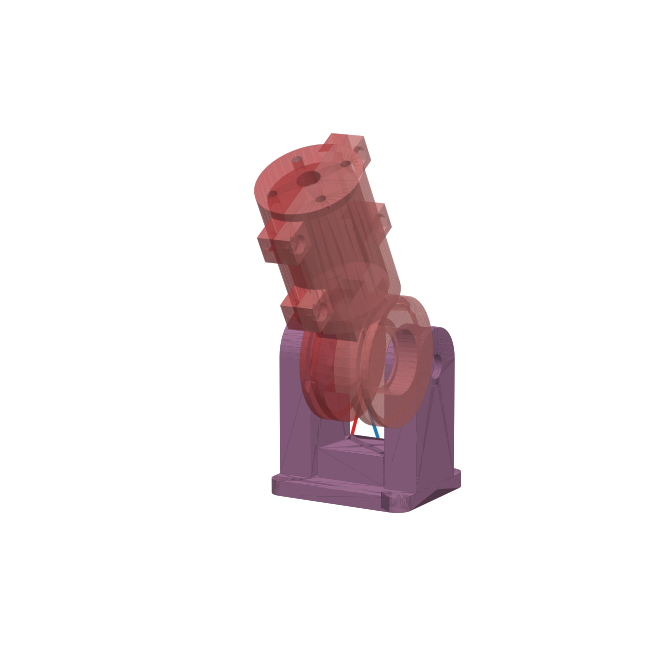
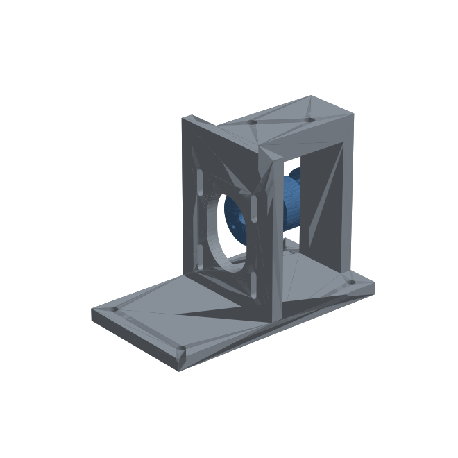

# J1b: two degrees of freedom, both motors remote

**J1-S (elbow) + J2 (wrist)**, driven by two NEMA17 steppers that sit away from the arm. This is the first time a tendon has to cross another joint to reach its own, which is the core problem of the torso design.



## Architecture

| | J1: elbow | J2: wrist |
|---|---|---|
| Drive | bare Dyneema tendons, straight lines | **Bowden**: Dyneema inside PTFE tubes (2/4 mm) |
| Motor location | base, under the joint | **separate Bowden-drive module** (place it anywhere; in the torso later) |
| Drum / spool | r 36 / r 6 → **6:1** | r 20 / r 6 → **3.33:1** |
| Torque (NEMA17 ~0.3 N·m usable) | ~1.6 N·m | ~0.7 N·m after Bowden friction (~30%) |
| Range | ±95° (checked with J2 attached) | ±110° (checked) |
| How its tendons cross the other joint | — | the PTFE tubes run through J1's open center |

**Why Bowden for J2.** A cord inside a tube anchored at both ends only moves relative to the tube. Bending J1 bends the tube but shouldn't pull the cord, so the two joints stay independent without software compensation. The cost is friction, which is acceptable for the wrist and gripper but not for the elbow or shoulder. Measuring how much friction and how much leftover coupling is the main experiment here.

**Mounting J2.** The J2 mount bolts to a flange on J1's distal link with a square pattern (4× M3 into heat-set inserts). That pattern is 90° symmetric:
- mount it **perpendicular** (default) for elbow pitch + wrist yaw, so the arm moves in 3D;
- turn it 90° for a **parallel** axis, which makes a planar 2-link arm.



J2 works like a small J1-S. Each tendon leaves its PTFE tube at an angled socket in the mount, aimed exactly along the tangent to the drum (red/blue lines above), so the cord never rubs an edge. The drum has its own open center and a hole in the end plate, ready for the gripper's Bowden cable.



The **Bowden-drive module** is a NEMA17 with the same helical spool as J1-S. Both tube sockets sit directly above the spool's tangent points. As before, you tension by sliding the motor down in its slots. It has its own foot plate with 4 screw holes, so you can put it next to the base, or later bolt several in a row into the torso.

## Checked in CAD (`tools/check_j1b.py`)

- All new parts are valid single solids with watertight STLs.
- J2: **no collisions over ±110°**.
- J2 cords from tube exit to drum tangent, plus the groove path over the drum: **no contact** with the mount or the J2 links.
- J1 with the whole J2 module attached (J2 at −90°, 0°, +90°): **no collisions over ±95°**.
- J2 mount on the J1 flange: touching, not overlapping.

Not checked: the PTFE tube's real path inside the links (it's flexible and finds its own way), friction, and print tolerances.

## Parts

New parts are in `stl/`. The rest are reused from [J1-S](../j1s-hinge/).

| Qty | File | From | Print |
|---|---|---|---|
| 1 | `j1_proximal_through.stl` | here | flange down, support under the cap. Same as J1-S proximal but the tube holes go **through** |
| 2 | `j1_distal_half_mount.stl` | here | split face down. J1-S distal with the **mount flange** |
| 1 | `j2_mount.stl` | here | plate down |
| 2 | `j2_distal_half.stl` | here | split face down, print twice |
| 1 | `bowden_drive.stl` | here | foot down. The socket bar is a 47 mm bridge: fine on most printers, or use supports |
| 2 | `spool.stl` | J1-S | one for each motor |
| 1 | `base.stl` | J1-S | |

Hardware, on top of the J1-S list:

| Qty | Part |
|---|---|
| 1 | 2nd NEMA17 + 2nd driver (TMC2209) |
| 2 | 608 bearings, 2× M8×20 bolt + nut + washer (J2 axle) |
| 4 | M3 heat-set inserts (4.0 mm hole) + M3×10 (J2 mount to flange) |
| 4 | M3×12 + nut (J2 halves) |
| 4 | M3×10 + washer (motor 2 into its slots) |
| ~1.4 m | PTFE tube 2 mm ID × 4 mm OD (two Bowden lines, ~650 mm each, trim to fit) |
| ~2 m | 1 mm Dyneema (two J2 tendons ~0.9 m each) |

## Assembly notes (beyond J1-S)

1. Melt the 4 heat-set inserts into the J1 distal flange before joining the halves.
2. **J2 tendons:** knot each one into its drum anchor as in J1. Lay the flexor over the top toward +Y' and the extensor the other way. Bolt the J2 halves together and fit them into the J2 mount (M8 nuts in the lug slots, washers, M8×20).
3. Thread each J2 cord down through its angled socket in the mount, then into its PTFE tube. Push the tube up into the socket until it stops.
4. Bolt the J2 mount onto the J1 flange, parallel or perpendicular. Feed the two tubes down through the J1 distal link, through J1's open center, through the cap's through-holes and out the bottom of the proximal link into the base.
5. Route the tubes out through a side window of the base to the Bowden-drive module. Use gentle curves (radius ≥ 25 mm) and leave a little slack. **Don't let the tubes touch J1's tendons.**
6. Push the tubes into the drive-module sockets and wind each cord 2 turns onto spool 2: flexor on the −X helix, extensor on the +X helix, both going *under* the spool. Knot them through the flange holes. Tension by sliding motor 2 down.

## Tests

- [ ] **Bowden friction:** measure J2's holding torque at the tip with J1 straight, then with J1 at 90°.
- [ ] **Coupling:** hold J2's motor still and sweep J1 ±90°. How many degrees does J2 drift? Ideal is 0. Anything left over goes into a compensation table.
- [ ] **Backlash:** the J2 Bowden pair against the J1 bare pair.
- [ ] **Tube creep / sheath compression:** load J2 for 12 h and re-measure.
- [ ] **Reorientation:** remount J2 parallel and repeat the coupling test. Is it the same?

## Regenerate

```bash
.venv/bin/python joints/j1b-2dof/j1b.py
.venv/bin/python tools/check_j1b.py
```
