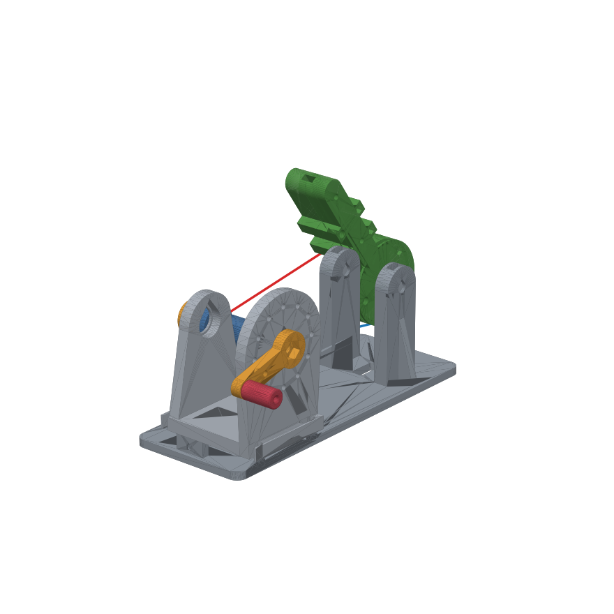
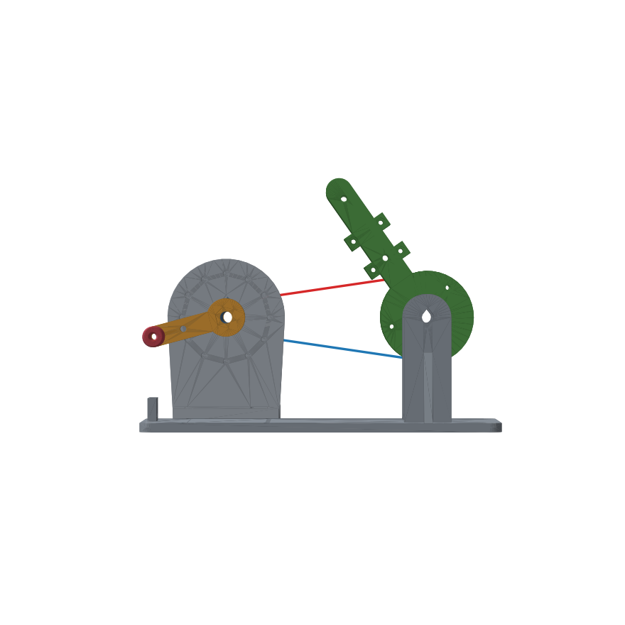
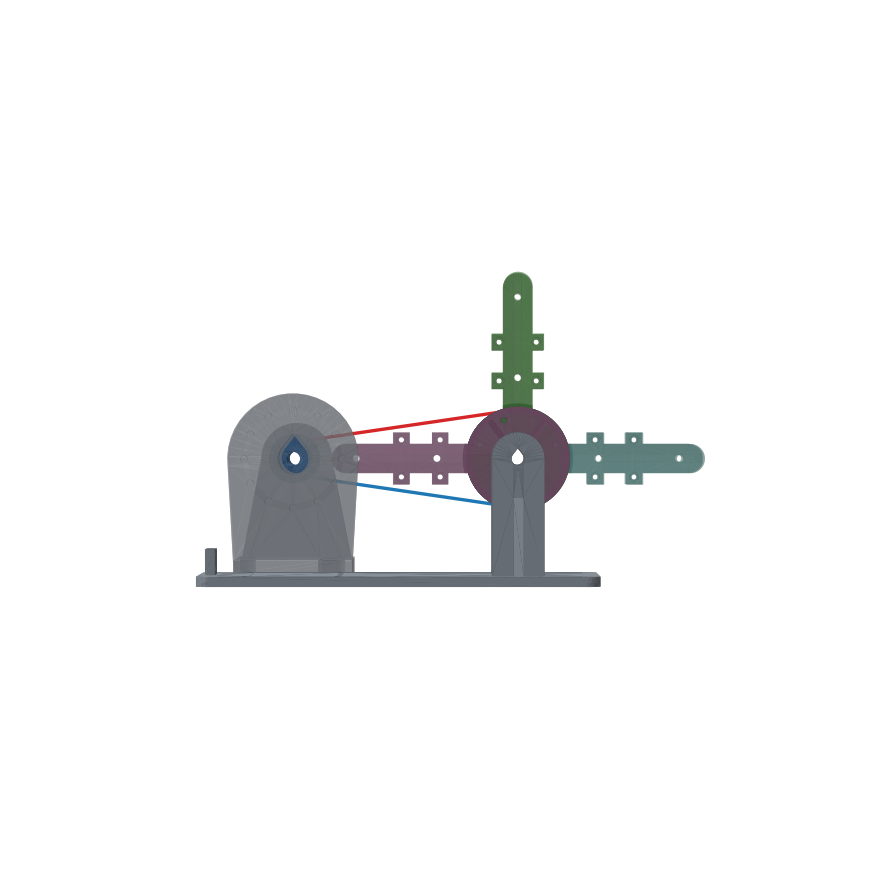

# J1-H: hand-cranked tendon hinge, 3:1 force multiplication (bench rig)

A desk-top rig to feel a tendon joint work before any motor is involved. A **hand crank** turns a small spool, two cords run as a cut-open belt to a drum three times as big, and the drum carries a **lever** you hang weights on. Everything that matters for the arm later is in it: a closed-loop antagonistic pair, cords on real bearings, an open joint centre, and a way to tension the loop.



## How it works

```
   side view, looking along the joint axis (+X towards you)

          lever (weights at 50 / 100 mm)
            |
       ____ |____                               crank frame
      /  drum r30 \   cord A (over the top)     ___________
     |   [open]    |<===========================(  spool  )  <-- crank, 50 mm,
      \___________/   cord B (under the bottom)  (  r10   )      turns 3x the joint
            ||                                   -----------
       hinge pylons                          slides on 4 slots, pushed back
         (2x 608)                            by one M4 screw = tension
```

* **3:1 by radius.** Cord tension is the same all along a cord. The drum's cord radius is 30 mm, the spool's is 10 mm, so the torque on the joint is 3 x the torque on the spool, and the crank turns 3 x the joint angle (+-90 deg of joint = +-270 deg of crank, 3/4 of a turn). The crank handle and the first lever hole both sit at 50 mm: **a weight hanging on the lever is held by one third of it at the handle.**
* **Closed loop, no slack.** Cord A leaves the top of the spool and wraps the far side of the drum one way; cord B leaves the bottom of the spool and wraps the far side the other way. Turning the crank winds one on and pays the other out by exactly the same length, so the joint is stiff in both directions and there is no spring to fight.
* **Straight cords on bearings.** The two free spans are straight external tangents (136 mm, 8 deg slope), nothing rubs. Drum and spool each run on two 608 bearings. Hand-turned with nothing hanging, the lever should flop freely.
* **Open centre.** The drum is hollow between its bearings, with a slot in the bottom (+-100 deg) and a channel up the lever. A cord dropped through the hole in the base plate, up through the drum and out of the lever tip crosses the joint on its axis, so it does not change length when the joint moves. That is the pass-through test from [J1](../j1-hinge/), here on a rig you can actually turn.
* **Tensioning without tools in the loop.** The crank frame sits on four slotted screws. One M4 screw in the block behind it pushes the whole frame away from the drum, which lengthens both cord paths at once. Coarse length is set once with the knots.



Range of motion (teal -90 deg, green 0, purple +90 deg). Positive = lever tips towards the crank; past about +91 deg the lever tip meets the lower cord, so treat +90 as the stop. On the other side the lever can go to -120 deg without touching anything.



## Key numbers (all parameters are at the top of `j1h_hand.py`)

| | |
|---|---|
| Cord | 2.5 mm braid (grooves, holes and knot pockets are sized for it; change `CORD_D` for another) |
| Drum / spool cord radius | 30 mm / 10 mm, ratio **3.00** |
| Crank radius, lever holes | 50 mm; 50 and 100 mm |
| Joint range | -90..+90 deg (crank -270..+270 deg) |
| Cord take-up per 90 deg | 47 mm = 0.75 spool turns |
| Drum wrap at 0 deg | 135 deg per cord (45 deg left at the end of the range) |
| Spool | 2.5-turn helix per cord, pitch 4.5 mm, 1.25 turns wound at 0 deg (0.5 .. 2.0 over the range) |
| 1 kg at 100 mm | 0.98 N.m on the joint, 33 N in the cord, **6.5 N (0.67 kg) at the handle** |
| 2 kg at 100 mm | 1.96 N.m, 65 N cord, 13 N at the handle |
| Footprint | 96 x 247 mm base plate, joint axis 72 mm above it |

## Bill of materials

| Qty | Part | Note |
|---|---|---|
| 1 | `base.stl` | flat, pylons up. No supports |
| 1 + 1 | `drum_a.stl`, `drum_b.stl` | **hub face down** (as exported). The two halves differ only in where their cord anchors, so print one of each |
| 1 | `frame.stl` | foot down |
| 1 | `spool.stl` | standing on a flange |
| 1 | `crank_arm.stl` | outer (hex pocket) face down |
| 1 | `nut_cup.stl` | outer face down |
| 1 | `knob.stl`, 1 `lock_pin.stl` | as exported |
| 4 | 608 bearing (8 x 22 x 7) | 2 in the drum, 2 in the crank frame |
| 2 | M8 x 25 bolt + M8 nut + M8 washer | hinge stub axles; the nut drops into the slot in each pylon, the washer sits between drum and pylon on the inner race |
| 1 | M8 x 100 bolt + M8 nut + 2 M8 washers | crank shaft: head in the crank arm, nut in the nut cup. A washer between each spool flange and its bearing |
| 4 | M3 x 20 + nut | lever tabs (joins the halves) |
| 2 | M3 x 35 + nut | through the hub at 20 and 160 deg |
| 4 | M4 x 16 + nut | crank frame to base plate (nuts in the pockets under the plate) |
| 1 | M4 x 30 + nut | knob |
| 1 | M4 x 40 + nut | tension screw in the block behind the frame |
| 2 x 0.6 m | 2.5 mm braided cord | polyester or Dyneema braid. Nylon paracord works for a first try but creeps and stretches |

Print settings: PETG or PLA+, 0.2 mm layers, 4 walls, 30 % infill. `tools/printability.py` passes every part; it flags ~2 % "thin wall" on the spool, which is the crest between the groove turns (1.7 mm land), not a wall.

## Assembly

1. **Drum halves.** Tie a stopper knot (figure-8) in each cord. From the open centre of each half, push the other end out through the slanted anchor hole so it comes out in the groove: cord A on `drum_a`, cord B on `drum_b`. Pull until the knot seats inside the cavity (you can see it through the bottom slot). Lay each cord round its groove towards the top of the drum. Press a 608 into each half.
2. Bolt the halves together: 4 x M3 x 20 through the lever tabs, 2 x M3 x 35 through the hub. Heads go in the counterbores, nuts in the hex pockets of the other half.
3. Drop an M8 nut into the slot in each pylon. Set the drum between the pylons with the lever up, an M8 washer in each gap, and screw the M8 x 25 bolts in from the outside. Snug, do not crush the bearings. The lever should swing freely.
4. **Crank frame.** Press a 608 into each wall. Stack on the M8 x 100: crank arm (head in its hex pocket) -> through wall B's bearing -> washer -> spool -> washer -> wall A's bearing -> nut cup -> nut. The spool's helix with the cord A anchor goes on the -X side (away from the crank). Tighten until the stack is clamped and the spool still turns smoothly with the crank.
5. Put 4 M4 nuts in the pockets under the base plate, set the frame on its slots with the screws at the drum end of the slots (frame closest to the drum), tighten lightly. Screw the M4 x 40 into the block behind the frame until it touches the foot.
6. **Cords.** Lock the crank with the pin in the top index hole and hold the lever straight up. Cord A runs from the top of the drum straight to the top of the spool, round the far side and down, 1.25 turns along the -X helix, then through the axial hole in the flange. Pull it hand-tight and tie a stopper knot in the notch on the flange's outer face. Cord B: from the bottom of the drum to the bottom of the spool, round the far side and up, 1.25 turns along the +X helix, through its flange hole, knot in the notch.
7. **Tension.** Loosen the 4 frame screws, turn the tension screw until both cords are taut (push the frame back by hand first if there is a lot of slack), tighten the frame screws. Re-tension after the first few minutes of use: new cord settles.

## Tests this rig is for

- [ ] **Ratio.** Lever horizontal pointing away from the crank (-90 deg: crank also horizontal). Hang 1 kg on the 100 mm hole and hold the handle with a luggage scale: expect about 0.67 kg. Hang it on the 50 mm hole: expect one third.
- [ ] **Backlash.** Pin the crank, wiggle the lever. Then slacken the tension screw a turn and feel the difference.
- [ ] **Stretch and creep.** Pin the crank, hang 2 kg on the lever, mark the angle, leave it overnight.
- [ ] **Friction.** Unpin the crank, push the lever by hand: it should back-drive the crank easily. Any notchiness points at a cord riding out of its helix.
- [ ] **Pass-through coupling.** Drop a spare cord through the hole in the base plate, up through the drum and out of the lever tip. Mark it at the tip, sweep the joint -90..+90 deg and measure how far the mark moves. Ideally ~0.

## Regenerating

```bash
.venv/bin/python joints/j1h-hand/j1h_hand.py   # STL + STEP -> joints/j1h-hand/stl/
.venv/bin/python tools/check_j1h.py            # groove/cord checks, collisions, previews
.venv/bin/python tools/printability.py joints/j1h-hand/stl
```

The checks in `tools/check_j1h.py` put 0.4 mm test balls along the intended cord paths (drum arcs at -90/0/+90 deg, spool helices) and confirm they sit free in the grooves, sweep the lever against base, frame and spool from -120 to +120 deg, run the free cord spans as 2.5 mm rods against every part, and turn the crank arm a full circle against its frame.
