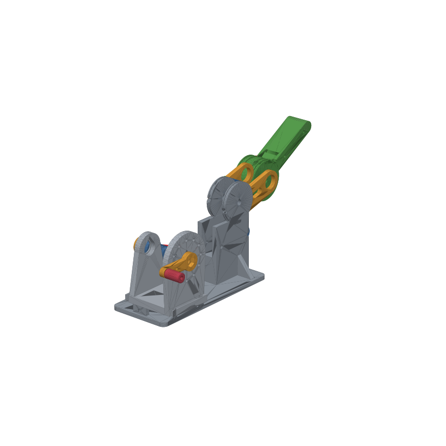
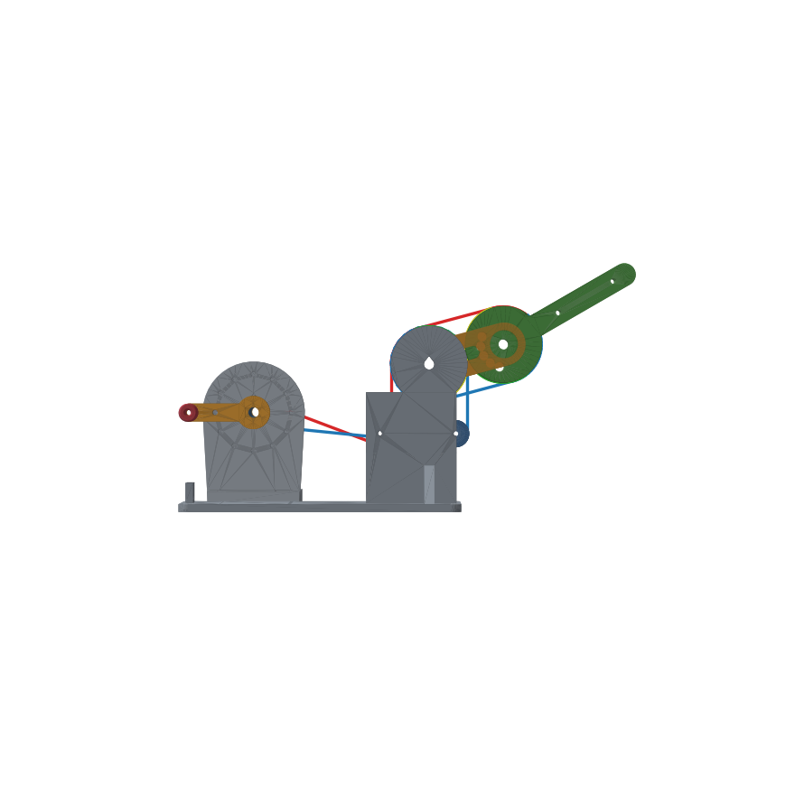
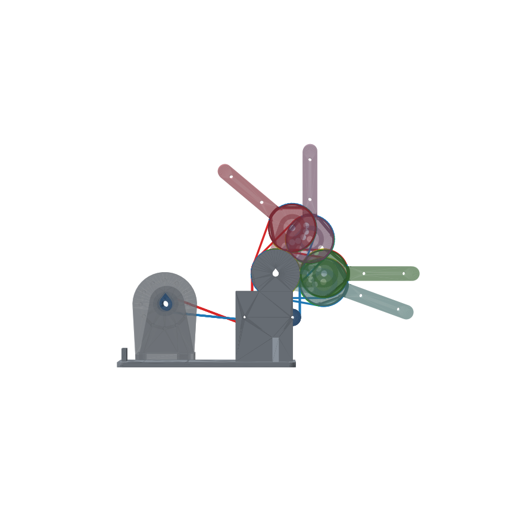
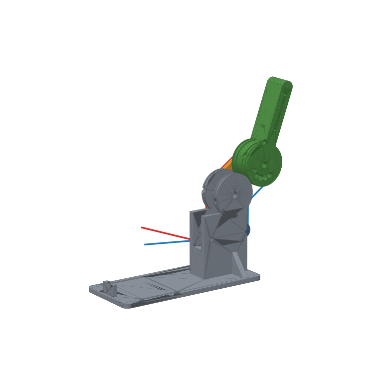

# J1-R: rolling elbow (LIMS style), hand-cranked, 3:1

The elbow of the LIMS / AMBIDEX arm is not a pin joint. Two equal pulleys, one on each link, roll on each other; a short link on bearings keeps their centres at a fixed distance and two **crossed cables** force them to roll without slipping. The actuating wires run over pulleys at the centres, so they can come from far away. This is that joint, 3D-printed for a 2.5 mm braided cord, with the hand crank and 3:1 drive of [J1-H](../j1h-hand/) behind it.



## How it works

```
   side view, looking along the elbow axis (+X towards you)

                  cord A (flexor)
        ,------------------->--------.
       /   idler r30 (free)          \  pulley 2 r30 (= forearm hub)
      |      C1 ( o )===side plate===( o ) C2 ----- forearm, weights at 50 / 100 mm
       \   pulley 1 (two discs,      /  \
        `---- part of upper arm) ---'    `-- X1, X2: crossed restraint cords, anchored on both pulleys
        |  |                        cord B (extensor), under the idler
   roller A  roller B (90 deg turn, 623 bearings)
        |  |
        cords run back along the base to the crank spool (r10) of J1-H
```

* **Rolling pair.** Pulley 1 is two discs that grow out of the upper arm (the base plate's tines). Pulley 2 is the hub of the forearm. Both have cord radius 30 mm; their bodies stay 1 mm apart, the cords are the contact. Two side plates on 608 bearings hold the centres 61 mm apart. When the forearm turns by θ the side plates turn by θ/2: the joint's centre of rotation moves, as in a knee or in LIMS.
* **Restraint cords X1, X2.** Each is anchored on pulley 1, runs round it to the contact point, crosses onto pulley 2 and runs the opposite way to its anchor there. The pair forms an X at the contact. Any slip would lengthen one of them, so the pulleys roll (the Jacob's-ladder principle LIMS cites). They also carry the joint load like ligaments, so tie them tight.
* **Drive A, B.** Both cords come from the crank spool along the base, turn 90° up over a small roller under the elbow, climb onto a free **idler** that sits between the two pulley‑1 discs on the same axle, run along the common tangent of idler and pulley 2 (A over the top, B under the bottom) and are anchored on pulley 2. The idler turns freely, so nothing slides. Because the tangent stays parallel to the centre line, each cord changes length by exactly R·θ: **moment arm 30 mm over the whole range**, and the crank (spool r = 10 mm) turns 3× the joint angle. Cord tension is the same everywhere, so the torque on the elbow is 3× the torque on the crank.
* **Tension.** Drive loop: slide the crank frame back on its slots with the M4 screw, as on J1-H. Restraint cords: knots pulled tight (LIMS uses set screws; a screw tensioner is the obvious upgrade).
* **Range.** −20° (forearm down; beyond that cord B's vertical run would rub on pulley 2's groove bottom) to +140° (forearm folded back; cord A keeps 20° of wrap on the idler and 40° on pulley 2). The parts themselves clear each other from −40° to +160°; the cords set the limits.



Range of motion: teal −20°, green 0°, purple 90°, red 140°, with cords A (red), B (blue), X1 (green), X2 (olive):



The elbow at 70° with the near side plate removed:



## Key numbers (parameters at the top of `j1r_rolling.py`)

| | |
|---|---|
| Cord | 2.5 mm braid (`CORD_D`), 4 cords: A, B, X1, X2 at stations ±7 / ±14 mm |
| Pulley / idler cord radius, spool | 30 mm / 10 mm, ratio **3.00**, constant |
| Centre distance | 61 mm (2R + 1 mm gap) |
| Range | −20…+140° joint = −60…+420° crank (1.3 turns) |
| Cord A, B length change | −30 mm, +30 mm per 57.3° (= R·θ exactly; X1, X2 constant) |
| Restraint wraps at 0° | 110° on pulley 1, 100° on pulley 2; ≥ 30° left at both ends of the range |
| 1 kg at the 100 mm hole, forearm horizontal | 1.28 N·m about the rolling centre, 43 N in cord A, 0.43 N·m on the spool = **8.5 N at the 50 mm handle** |
| Footprint | 96 × 227 mm base plate, elbow axis 110 mm above it |

## Bill of materials

| Qty | Part | Note |
|---|---|---|
| 1 | `base.stl` | flat, tines up, no supports |
| 1 | `forearm.stl` | hub face down |
| 1 | `idler.stl`, 2 `roller.stl` | flat; roller bearing pocket up |
| 2 | `side_plate.stl` | flat |
| 1 | `spacer_idler.stl` ×2, `spacer_roller_A2.stl`, `spacer_roller_B1.stl` | standing. Print the idler spacer twice |
| 1 | `spool.stl` | standing; J1-H envelope, helices at ±7 mm |
| 1 each | `frame`, `crank_arm`, `nut_cup`, `knob`, `lock_pin` | the J1-H crank (same files) |
| 7 | 608 bearing | 1 idler, 2 per side plate, 2 crank frame |
| 2 | 623 bearing (3 × 10 × 4) | rollers |
| 1 | M8 × 70 + nut + 4 washers | elbow axle through tines, idler spacers and side plates |
| 1 | M8 × 65 + nut + 2 washers | forearm axle |
| 1 | M8 × 100 + nut + 2 washers | crank shaft (J1-H) |
| 2 | M3 × 40 + nut | roller axles (nut recessed in the −X tine) |
| 4 | M4 × 16 + nut | crank frame to base |
| 1 + 1 | M4 × 40, M4 × 30 + nuts | tension screw, knob |
| ~2 m | 2.5 mm braided cord | A ≈ 0.5 m, B ≈ 0.7 m, X1 and X2 ≈ 0.2 m each, before knots |

`tools/printability.py` passes 12 of 14 files; the two "failures" are heuristics: the 3.4 mm wide ceilings of the restraint grooves where they tunnel through the tine stems (short bridges) and the crests between the spool's helix turns.

## Assembly

1. **Rollers.** Press a 623 into each roller. M3 × 40 through the +X tine (head in its recess), spacer, roller A at station −7 (behind the elbow) or B at +7 (under it), spacer, nut in the −X tine's pocket.
2. **Idler and side plates.** Press the 608 into the idler. Press a 608 into each end of both side plates. Slide the M8 × 70 from +X: washer, side plate B bearing, washer, through the +X tine, idler spacer, idler, idler spacer, −X tine, washer, side plate A bearing, washer, nut. Tighten until the tines are clamped onto the spacers; the idler and the plates must spin freely.
3. **Forearm.** M8 × 65 through side plate A's bearing, washer, the forearm hub, washer, side plate B's bearing, nut. The forearm now hangs in the plates 61 mm from the elbow axle.
4. **Restraint cords.** X1: stopper knot in the pocket on the front‑bottom of pulley 2 (station −14), out into the groove, round under pulley 2 and up its back to the contact, across onto pulley 1's disc, over its top and down the back into the chord hole at 110°, out at the knot pocket on the back of the disc. Pull it as hard as you can and tie the stopper. X2 is the mirror image (station +14: pulley 2 top → contact → under pulley 1 → chord hole at 250°). Roll the forearm by hand: it should move without play and the two X cords should stay taut over the whole range.
5. **Drive cords.** Lock the crank with the pin, forearm horizontal. A: knot in the pocket at the bottom‑front of pulley 2 (station −7), out into the groove, up the front, over the top of pulley 2, straight back along the top tangent onto the idler, over the idler's top and down its back, straight down behind the elbow, under roller A and back along the base to the spool's top. B: knot in the pocket on pulley 2's front (station +7), under pulley 2, along the bottom tangent onto the idler, round the idler's bottom, back, top and front, straight down in front of the elbow, under roller B and back to the spool's bottom. On the spool each cord gets 1¼ turns in its helix (A on the −X helix, B on +X), then through the flange hole and a stopper knot in the notch.
6. **Tension** as on J1-H: loosen the four frame screws, turn the tension screw until both drive cords are taut, tighten.

## Tests this rig is for

- [ ] Rolling: with the drive cords slack, roll the forearm by hand. No play, no notchiness, the side plates turn at half the forearm angle.
- [ ] Ratio: forearm horizontal, 1 kg on the 100 mm hole, luggage scale on the handle: about 0.87 kg. Repeat at 45° and 90° of flexion: the reading must stay the same (constant moment arm), unlike a LIMS tackle whose arm falls with cos(θ/2).
- [ ] Restraint pretension vs stiffness: measure the forearm's deflection under 1 kg with the X cords tied loose and tied tight.
- [ ] Creep and friction as on J1-H.

## Not in this version

* Pass-through for a wrist cord. LIMS routes wrist wires in an X over pulleys on both centres so their length does not change; the same four stations can take two more idlers later.
* Screw tensioners for X1 and X2.

## Regenerating

```bash
.venv/bin/python joints/j1r-rolling/j1r_rolling.py
.venv/bin/python tools/check_j1r.py
.venv/bin/python tools/printability.py joints/j1r-rolling/stl
```
