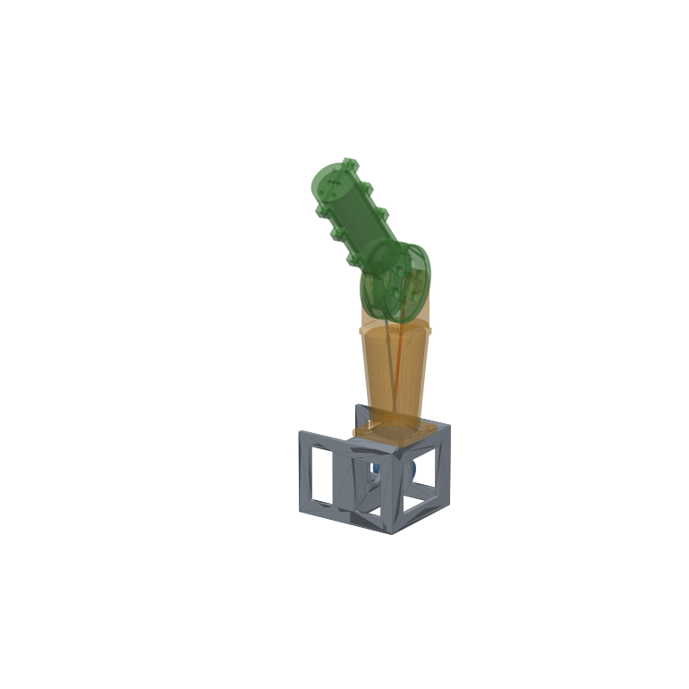
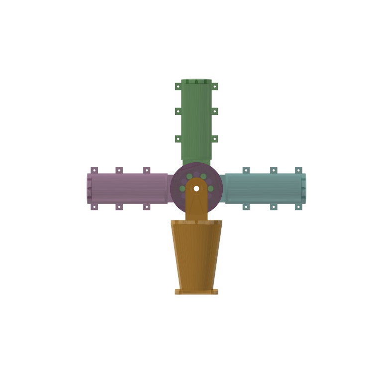

# J1-S: stepper tendon hinge with 6:1 tendon reduction

The second step after [J1](../j1-hinge/). It keeps the same idea (an antagonistic tendon pair and an open joint center) and answers three questions for the arm:

1. **Torque.** Can the tendon itself be the gearbox?
2. **Stepper drive.** Is a NEMA17 driving through a 6:1 tendon ratio stiff and precise enough?
3. **Tubes through the joint.** Do PTFE-lined Bowden tubes passing through the center work well enough for the gripper and wrist tendons?



## What's different from J1

| | J1 | **J1-S** |
|---|---|---|
| Motor | MG996R servo | **NEMA17 stepper** (42×40 mm, ~0.4 N·m) |
| Drum r / spool r | 15.5 / 15.5 mm | **36 / 6 mm** |
| Ratio | 1:1 | **6:1**: the tendon is the gearbox |
| Joint torque | ~1 N·m stall | **~1.6 N·m usable, ~2.4 N·m peak** |
| Tendon tension | ~65 N | ~45 N usable, ~75 N peak |
| Resolution | servo pulse | 200 steps × 16 microsteps × 6 = **0.02° per microstep** |
| Motor turns for ±90° | ±90° | **±1.5 turns** (helical spool, 4.5 turns of groove per tendon) |
| Center opening | 10 mm slot (bare cords only) | **14 mm × r 28 mm cavity**: up to 3 PTFE tubes (4 mm OD), bend radius ≥ 25 mm |
| Bowden sockets | — | 3 in the proximal cap, 3 in the distal end plate |
| Proximal link | Ø54 tube | tapers from 60×74 mm at the joint to Ø46 at the base |

Why the tendons converge: the drum (r 36) is much bigger than the spool (r 6), so the two tendons run on slanted lines that come together toward the motor. The proximal link tapers to follow them. That gives a roughly upper-arm shape, about human scale.



## Checked in CAD (`tools/check_j1s.py`)

- All parts are valid single solids, and the STLs are watertight.
- **No collisions over ±110°** of joint travel.
- Tendon centerlines (as 1 mm rods) don't touch the proximal link, the base or the neck over the drum.
- A 4 mm PTFE tube bent at a **25 mm radius** through the joint at ±90° clears both links.

Not checked: real print tolerances, the stepper's real torque at speed, and friction. That's what the printed rig is for.

## How the Bowden tube passes the joint

A tube anchored in the cap and in the distal end plate has a fixed length. When the joint bends, its path would get shorter if it took a tight inside curve. It can't, so it bulges into the open cavity on the outside of the bend, and its path length stays the same as when the joint is straight. That's why the cavity is big and open. **Cut the tube to the straight cap-to-end-plate length (≈ 198 mm), no shorter.**

Inside the tube, the cord moves only relative to the tube, so joint motion shouldn't move it at all. The cost is friction. That's what the test below measures.

## Bill of materials

| Qty | Part | Note |
|---|---|---|
| 1 | `proximal.stl` | flange down; support only under the cap |
| 2 | `distal_half.stl` | **print twice**, split face down, no supports |
| 1 | `spool.stl` | motor-side collar down; 0.12–0.16 mm layers for the helix |
| 1 | `base.stl` | already upside down (top plate on bed) |
| 1 | NEMA17 stepper, 5 mm D-shaft, ≥ 0.4 N·m | 40 mm or 48 mm body |
| 1 | Stepper driver (TMC2209 recommended) + 12–24 V supply + MCU (ESP32/Arduino) | |
| 2 | 608 bearing | |
| 2 | M8×20 bolt, M8 nut, M8 washer | stub axles |
| 6 | M3×12 + nut | distal halves |
| 4 | M3×16 + nut | proximal flange to base |
| 4 | M3×10 + washer | motor into its slots |
| 1 | M3×6 set screw + M3 nut | spool to shaft flat |
| ~1.6 m | 1 mm Dyneema / PE braid | two tendons, ~0.8 m each before trimming |
| ~0.4 m | PTFE tube 2 mm ID × 4 mm OD | Bowden test (up to 2 lines) |

Print in PETG or PLA+ with 4 walls and 40% gyroid. Use 100% infill around the lugs and the drum side walls if you can.

## Assembly

1. Press the 608s into the distal halves.
2. **Drum tendons:** for each half, tie a stopper knot, pull the line from the knot pocket through the chord hole into the groove and lay it over the top of the drum. Bolt the two halves together.
3. Drop the M8 nuts into the lug slots, set the drum between the lugs and thread each tendon down through its slot in the cap. Fit the washers and the M8×20 bolts.
4. **(Optional) Bowden:** push a 198 mm PTFE tube into a cap socket from above. Route it through the cavity and up the distal link, and push it into the matching end-plate socket. Run a test cord through it.
5. Bolt the proximal link to the base. Mount the motor loosely in its slots and slide the spool onto the shaft with the set screw on the flat.
6. **Spool winding**, with the joint straight and the motor still loose:
   - flexor (−X side): wrap **2 turns** into the motor-side helix, going under the spool, then out through the collar hole and knot it;
   - extensor (+X side): same, 2 turns into the outer helix, out through the end-flange hole, knot.

   Two turns each leaves 1.5 turns of travel in each direction plus margin.
7. **Tension:** push the motor down in its slots until both tendons are taut, then tighten.

## Test plan (write results into this README or an issue)

- [ ] **Stiffness:** push the tip with 1 kg (≈10 N at 158 mm) while the motor holds. How many degrees does it deflect?
- [ ] **Backlash:** reverse direction in microsteps. How many before the joint moves?
- [ ] **Max load:** hang weights at the tip until the stepper skips. Compare with the predicted ~1.6 N·m (≈1 kg at the tip).
- [ ] **Bowden friction:** pull the test cord through the tube with a spring scale at 0°, 45° and 90° joint angle. Compare with a bare cord.
- [ ] **Bowden coupling:** mark the test cord at the end plate and sweep the joint ±90°. How far does the mark move?
- [ ] **Creep:** hold 0.5 kg at the tip for 12 h and re-measure the angle.

## Regenerate / check

```bash
.venv/bin/python joints/j1s-hinge/j1s_hinge.py
.venv/bin/python tools/check_j1s.py
```

All dimensions are parameters at the top of `j1s_hinge.py`. Change `R_CORD_DRUM` / `R_CORD_SPOOL` to try other ratios. Torque goes up with the ratio, and so do tendon tension and the size of the proximal link.
