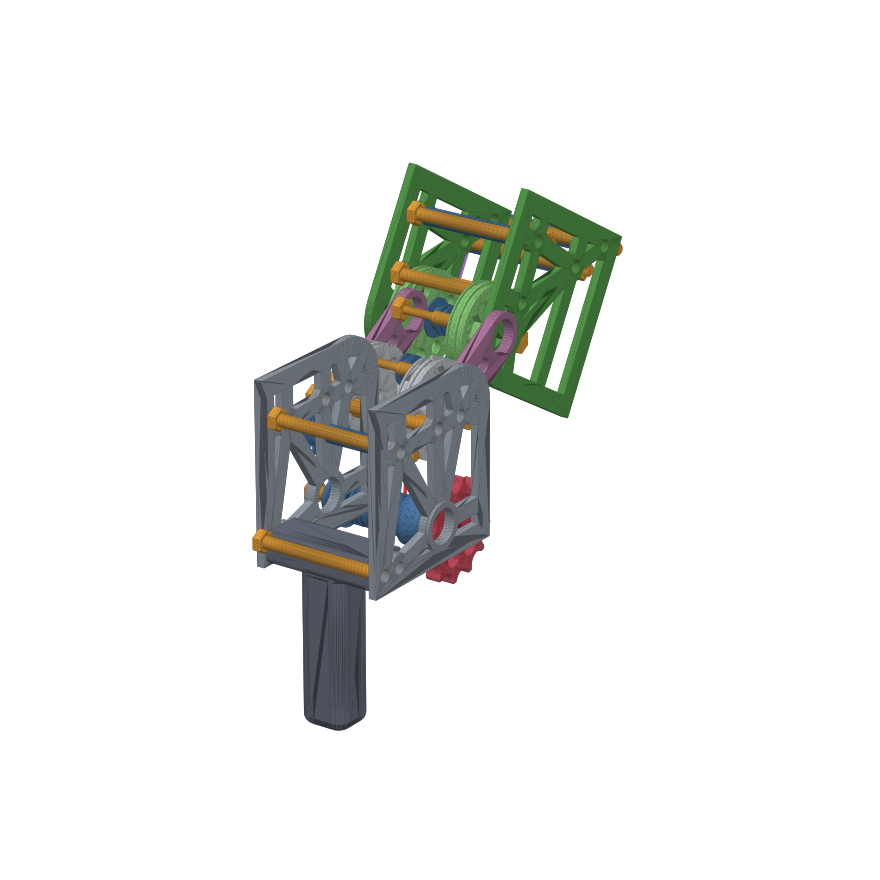
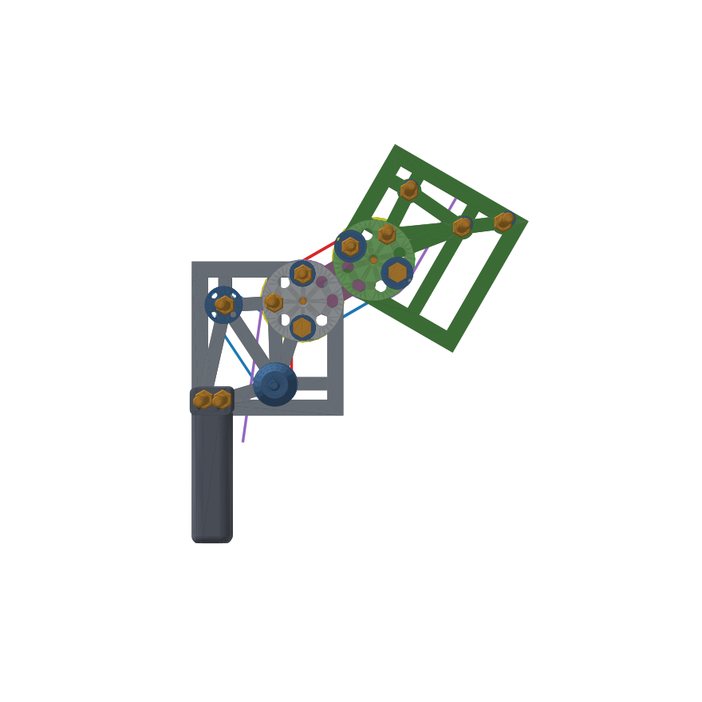
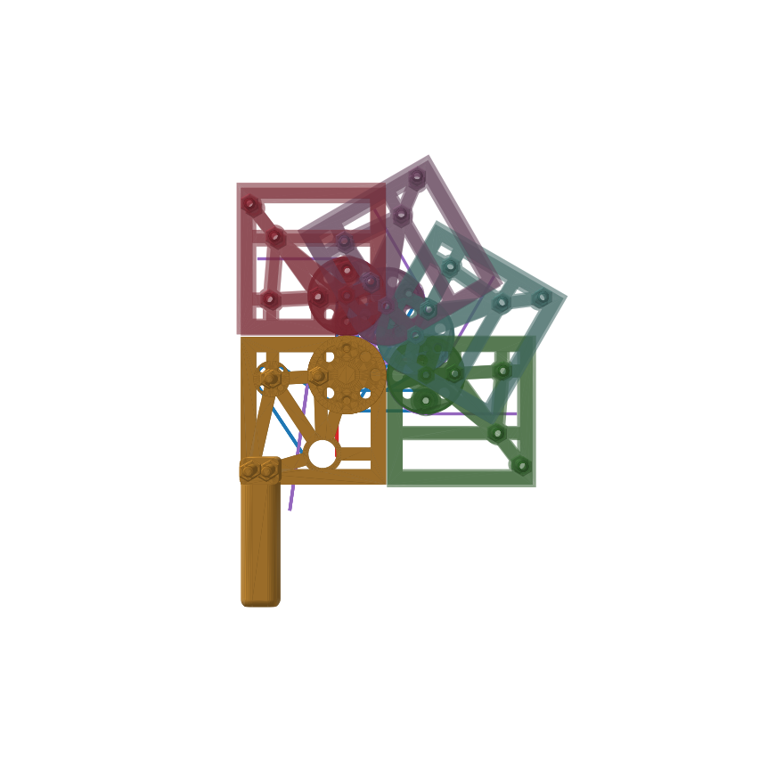
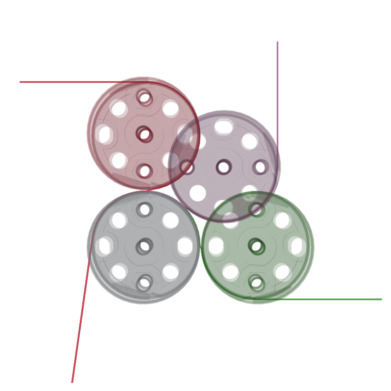
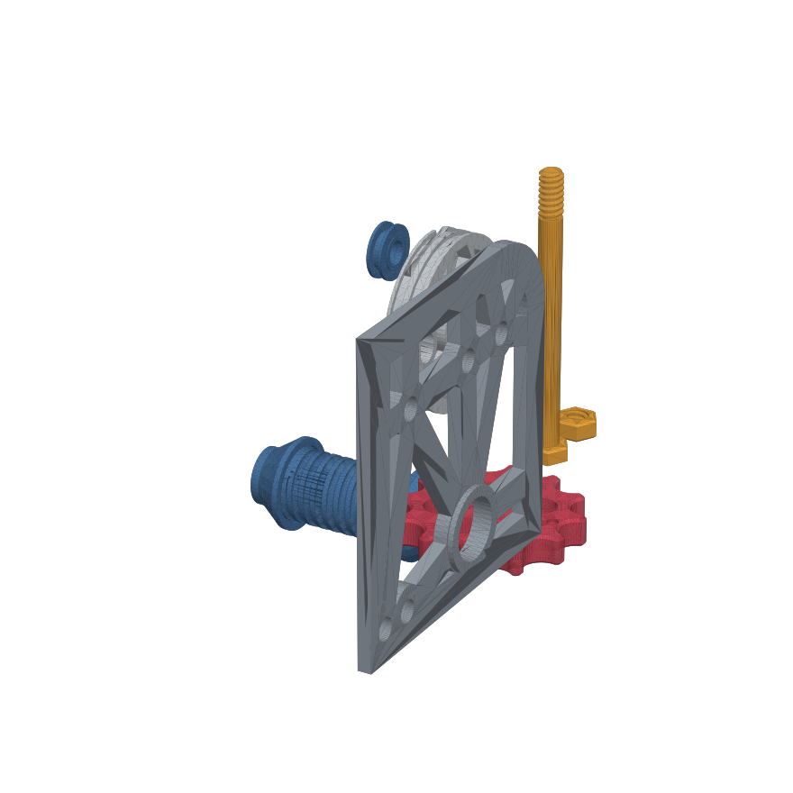

# J1-T: hand-held rolling elbow, block-and-tackle drive, printed screws

A rolling elbow built the way the Rhino sketch is built: every link is a **sandwich of two square plates with a quarter-round corner at the pin** on printed hex bolts, with the rolling discs and stacks of small grooved sheaves between them. The flats of the two plates meet at 0° (straight) and again at 180° (folded), so the joint turns through a full half circle. The reduction is a **block and tackle** (the LIMS tension amplifier): one cord reeved three times between a sheave block on the upper arm and one on the forearm. The **knob is in the hand**: it sits on the side of the handle above a pistol grip, there is no base plate. All screws, nuts and washers are printed; the only bought parts are six 608 bearings and the cord.



## How it works

```
   side view, looking along the pin axis (+X towards you), joint at 0 deg

   guide (-59,-3)  F1 (0,+20)  ===  3 runs  ===  F2            F = flexor tackle, x > 0
        \              |                           \
         \        (C1) o - - centre link - - o (C2)  forearm plate ->   discs r30 roll on each other,
          \            |                           /                    X1 / X2 crossed restraint cords
           \      E1 (0,-20)  ===  3 runs  ===  E2            E = extensor tackle, x < 0
            \     |
             \    '--- F cord straight down (y = -8) onto the front of the spool
              '------- E cord up from the back of the spool, over the guide, down onto the back of E1
              spool r12 at (-20,-62), knob on the +X plate, pistol grip below the plates
```

* **Rolling pair.** Each link has two discs (radius 30, 11.6 mm thick) between its plates. The discs of the two links do not touch (1 mm gap); the quarter-round corners of the plates roll edge to edge with the same gap, and the plate flats meet at 0° and at 180°, the hard stops. Two printed **centre links** on 608 bearings keep the pins 61 mm apart. Two crossed **restraint cords** X1, X2 in the inner grooves (anchored on both links with chord anchors, as on J1-R) force pure rolling. The forearm turns by θ, the centre links by θ/2.
* **Tackle.** Above each pin sits a block axle with sheaves (cord radius 8): on the upper arm F1 carries two sheaves, on the forearm F2 one sheave and an anchor ring. The cord is knotted at F2, runs to F1, back to F2, back to F1 (3 passes), then straight down onto the knob spool. The extensor tackle E1/E2 below the pins is the mirror image, entirely on the other side of the joint plane (x < 0), and the same cord continues from the spool up over a guide sheave and down onto E1. With the blocks straight above and below the pins the block distances are

      d_F = 61 - 40 sin(θ/2),   d_E = 61 + 40 sin(θ/2),

  so **d_F + d_E is constant**: one cord, one spool, nothing goes slack in either direction (checked to 1.2 mm over 180°). The spool is a capstan: the cord makes 5.5 turns in a single right-handed helix, no knots on the spool.
* **Ratio.** Elbow torque / knob torque = (3 · 20 · cos(θ/2) + 4) / 12 = **5.3 at 0°, 3.9 at 90°, 2.3 at 135°, 1.2 at 160°, 0.3 at 180°**; the knob turns 1.8 turns over the range. This is the tackle's nature (LIMS: moment arm (n d/2) cos(θ/2)): the leverage is gone at full fold, so the useful working range is 0 to about 150°. A spool-ratio drive like J1-R has a constant arm instead.
* **Knob in the hand.** The spool runs in two 608s in the handle plates; the knob is keyed to its stub with two flats and clamped by a printed nut. Hold the grip, thumb on the knob rim.
* **Pass-through.** The outer grooves T1, T2 are for cords going on to the next joint. A cord that wraps pulley 1 on one side, crosses at the contact point and wraps pulley 2 on the **other** side (a figure 8, exactly like the restraint cords) keeps a constant length at every angle; a cord that stays on the same side (an "S") changes by R·θ. `routing()` carries one such cord (T1, purple below): it comes up the back of the handle like the drive cord, between the spool flange and the grip, meets pulley 1 at 172°, runs over its top, under pulley 2 and out along the forearm. The check prints its length: constant to 0.2 mm.



Range of motion (forearm at 0°, 60°, 120°, 180°) with the drive cord (red / blue) and the pass-through cord (purple):



Pass-through cord at 0°, 90°, 180°:



Printed parts: handle plate, disc, sheave, bolt and nut, spool, knob:



## Printed screws

Thread "P8": 8 mm nominal, **2 mm pitch**, trapezoid with 60° flanks, 1.2 mm deep. The bolt carries the nominal profile; every internal thread is that profile **offset by 0.22 mm** (`THREAD_OFFSET`, the clearance measured on printed test pieces). The smooth shank is 7.9 mm (bearing bores). Four bolt lengths, all with a 13 mm hex head:

| Bolt | Shank | Where |
|---|---|---|
| `bolt` ×8 | 96 mm | plate-to-disc bolt and plate-to-plate bolt (1 + 1 per link), grip ×2, forearm weight hooks ×2 |
| `bolt_block` ×4 | 21 mm neck + 27 mm shank | block axles: head in a hex pocket of one disc, 5 mm neck across the other tackle's side, 7.9 mm shank under the sheaves, thread in the opposite disc |
| `bolt_pin` ×4 | 28 mm | pin stubs: through the plate and the centre-link bearing into the disc |
| `bolt_spool` ×1 | 21 mm | −X spool axle, into the spool hub |

Printed threads in the discs (pins, block axles) and in the spool hub; the long bolts take printed nuts. Print bolts standing (head down), nuts and washers flat. CadQuery note: OCC silently drops a cylinder that is coaxial with a helical sweep from a union or a cut, so every thread core and threaded bore is a 48-sided prism (`prism()`), and internal threads are cut in two passes (bore, then ridge).

## Why the centre of the joint is open

At 180° the extensor runs stand vertically through both pin axes and 8 mm from the flexor block axles, and the flexor runs likewise through the extensor side. So: the pins are two short stubs threaded into the discs; each block axle is a stepped bolt whose 7.9 mm shank only spans its own tackle's side and whose 5 mm neck crosses the other side (the runs pass it with 4 mm to spare); the guide sheave sits 59 mm behind the pin where no run ever reaches. The centre links sweep the region between the discs and the plates out to 20.5 mm from each pin (with 11 mm spacers), so the only bolt through that zone (`PLATE_BOLT`) sits 22 mm behind the pin, 1.5 mm outside the sweep and 1.5 mm inside the restraint-groove wall; the guide-to-sheave run passes it with 5 mm to spare. These positions came out of a small constraint search in the design session; move any of them and re-run the checks.

## Key numbers

| | |
|---|---|
| Cord | 2.5 mm braid; one drive cord ≈ 1.15 m, X1 / X2 ≈ 0.24 m each |
| Discs | r 30 cord radius, 1 mm gap, grooves X at ±18.5, T at ±24, recessed to a 4 mm web; plates 114 × 116 mm truss (12 mm rim, 10 mm struts, every bay braced by a diagonal) with the quarter-round corner |
| Blocks | 20 mm above / below the pins, sheaves r 8, 3 passes, pitch 6.2; blocks 2 mm apart at 180° |
| Spool / knob | r 12 helix, 5.5 turns wrapped, hollow core open through the threaded hub; knob r 32 scalloped with windows; guide sheave r 12 behind the discs |
| Ratio | 5.3 at 0°, 3.9 at 90°, 2.3 at 135°, 0.3 at 180° (cos θ/2), knob 1.8 turns for the range |
| Range | 0…180°, plate flats as hard stops; leverage useful to about 150° |
| Width | 85 mm over the plates, 100 mm over the pin stub heads, knob 16 mm beyond the +X plate |
| Bearings | 6 × 608 (4 centre links, 2 spool) |
| Printed volume | about 490 cm³ in all (plates 43, discs 18, grip 64, spool 27, knob 19 cm³ each); the first version was 720 |

## Bill of materials (printed)

| Qty | Part | Note |
|---|---|---|
| 2 + 2 | `plate_handle`, `plate_forearm` | flat, inner face down; the second of each is the same file flipped |
| 4 | `disc` | flat; every block hole has a hex pocket outside and a thread inside, so one file fits all four places |
| 6 + 2 | `sheave`, `anchor_ring` | flat |
| 1 | `guide` | flat |
| 2 | `centre_link` | flat |
| 1 | `spool` | standing on the −X hub |
| 1 | `knob` | flat |
| 1 | `grip` | tang down; solid 20 mm tang, hollow handle open at the bottom |
| 8 / 4 / 4 / 1 | `bolt`, `bolt_block`, `bolt_pin`, `bolt_spool` | standing |
| 9 | `nut` | flat |
| 16 | `washer` | flat |
| 4 | `spacer_block` (10.2) | disc → plate on the plate-to-disc bolts |
| 2 | `spacer_mid` (31) | between the discs on the plate-to-disc bolts |
| 1 + 1 | `spacer_guide_a` (21.8), `spacer_guide_b` (44.8) | either side of the guide on its plate-to-plate bolt (OD 11) |
| 1 | `spacer_plate` (75) | the forearm's plate-to-plate bolt |
| 2 / 2 | `spacer_sheave_F1b` (3.5), `spacer_sheave_F2a` (3.4) | fillers on the block axles (OD 11) |
| 2 | `spacer_bar` (75) | forearm weight hooks |

## Assembly

1. **Discs and blocks.** Two identical discs per link. The F block bolt enters from the −X disc: its neck crosses to the joint plane, then on the shank sit the 3.5 mm filler and, for the upper arm, the sheaves at x = 6.1 and 12.3 (bosses touching); it screws into the +X disc until the pocket seats the head. The E block bolt is the same from the +X side. The forearm is the same with the anchor ring (x = 3.0, knot hole towards the joint plane) and one sheave (9.2) on F2, mirrored on E2. The discs are now 31 mm apart.
2. **Plate bolts.** The plate-to-disc bolt behind the pin carries a 31 mm spacer between the discs and a 10.2 spacer outside each disc (all OD 11: the centre links pass 1.5 mm from them). The plate-to-plate bolt far back carries, on the upper arm, the 21.8 spacer, the guide (x = −11.5, wide groove) and the 44.8 spacer; on the forearm one 75 mm spacer. Plates on, nuts on.
3. **Centre links.** Press four 608s into the two links. On each side of each link: washer, bearing, washer between the disc's outer face and the plate; the pin stub bolt goes through the plate (washer under its head) and screws into the disc. Tighten until the inner race is clamped; the link must swing freely.
4. **Restraint cords.** X1 (−X groove): knot in the pocket at 285° of the upper arm's −X disc (bottom front), round the back over the top, across the contact, under the forearm's −X disc and up its front to the chord at 50°, out at 105°. X2 is the mirror image in the +X grooves (75° → under the upper arm → over the forearm → 310°, out at 255°). Pull hard, tie stoppers; roll the forearm by hand: no play.
5. **Spool and knob.** 608 in each handle plate (from the outside, the boss faces out). Spool between the plates with a washer on each hub; the +X stub goes through its bearing, then washer, knob (flats) and nut; the −X side takes the spool bolt through a washer into the hub.
6. **Drive cord.** Knot one end through the flange hole of the anchor ring on F2 (top block of the forearm). Forearm straight, knob pointer up. Reeve: F2 anchor → over the back of F1 sheave 1 (x = 6.1) → under the front of F2 sheave → over the back of F1 sheave 2 (12.3) → straight down the back of that sheave onto the **front** of the spool → 5.5 turns round the spool (the groove walks from x = +12.3 to −12.3) → up from the **back** of the spool, behind the discs, over the top of the guide → down onto the back of E1 sheave 2 (x = −12.3), under it → over the front of E2 sheave → under E1 sheave 1 → to the anchor ring of E2 (bottom block of the forearm). Pull the slack out through the E2 anchor and knot it.
7. **Grip.** Two long bolts through the plates and the tang.

## Tests this rig is for

- [ ] Rolling with the drive cord slack: no play, the centre links turn at half the forearm angle.
- [ ] Ratio: forearm horizontal, 0.5 kg on the 80 mm weight hook, spring scale on the knob rim (r 32): expect 0.5 · 80 / (5.3 · 32) ≈ 0.25 kg at 0°, about 0.5 kg at 120° and no holding power near 180° (the cos θ/2 fall-off of the tackle).
- [ ] Slack: turn the knob through the range, both tackles must stay taut (the checked total length drifts by < 1 mm).
- [ ] Capstan: with the weight on, does the cord creep on the spool? (5.5 turns should hold at any tension ratio.)
- [ ] Pass-through: tie a marker on a cord through T1 routed as a figure 8, move the joint: the marker must not move. Route it as an "S" instead: it moves by R·θ.
- [ ] Printed threads: how many turns do the bolts survive, do the disc threads strip when the block bolts are tightened.

## Not in this version

* Tensioner for the restraint cords and the drive cord (knots only; a printed screw tensioner at the E2 anchor is the obvious upgrade).
* Lock for the knob (J1-H's index pin would fit on the handle plate).

## Checks

`tools/check_j1t.py`: every part one valid solid, STLs watertight; bolt heads, nuts, washers and spacers of each link clear of its plates and discs; printed bolt thread free in the printed nut at the matching phase; cord lengths vs angle (table above); 0.4 mm balls along every cord free in every groove at 0 / 60 / 120 / 180°; straight runs as 2.5 mm rods clear of all parts (the remaining 0.1–0.3 mm³ are the tilted rod ends at the sheave tangent points); forearm, centre links and knob clear of the upper arm from −10° to 180°.

`tools/printability.py`: 13 of 24 files pass. The "failures" are the heuristic's thin-wall rule on the thread crests of the bolts, nuts, discs and spool helix, and on the 1 mm sheave / guide flanges. No unsupported overhangs.

## Regenerating

```bash
.venv/bin/python joints/j1t-tackle/j1t_tackle.py
.venv/bin/python tools/check_j1t.py
.venv/bin/python tools/printability.py joints/j1t-tackle/stl
```
